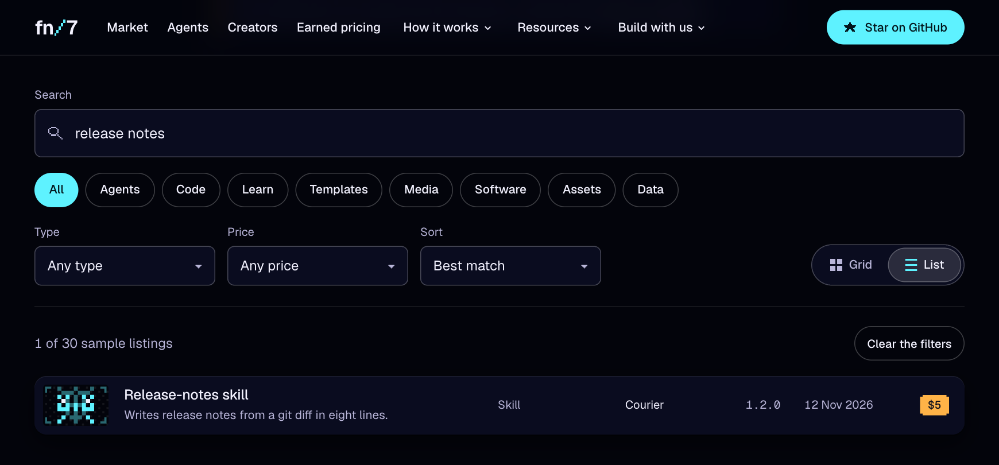

# A search inside fn/7

Suppose you have two Git tags and need release notes. In fn/7’s public development build, you can search for that job and inspect the access a tool requests. This walkthrough uses sample listings and prices. Checkout is in development.

## Find a tool by task

Open the market and search for `release notes`. The sample catalog narrows from 30 listings to one, **Release-notes skill**. Select **List** to see the same view shown here, then open the result.



## Decide whether it fits

The listing says the skill reads a Git diff and turns it into up to eight lines of changes a user would notice. It names Claude Code and Cursor as supported tools. The creator declares that the skill needs Git access and uses neither the network nor secrets. Open **What’s inside** to inspect the example file list and **Preview** to read the instructions.


[Inspect this sample’s source](https://github.com/erickdronski/fn7/blob/e93a2309b8553f638c2eba657326054dbfa1ca8b/lib/seed.ts#L143-L176)

## Run the same preview

[Download the source used for these screenshots](https://github.com/erickdronski/fn7/archive/e93a2309b8553f638c2eba657326054dbfa1ca8b.zip). Unzip it and open a terminal in the extracted folder. With Node.js 22 or later and pnpm 10 installed, start the storefront with these commands.

```sh
pnpm install --frozen-lockfile
pnpm dev
```

Open `http://localhost:4317/market` and repeat the search. You can browse the sample catalog without an account or API key.

What else would you want to know before giving a tool access to your repository? [Share an idea for fn/7](https://github.com/erickdronski/fn7/discussions/categories/ideas)
